<p align="center">
  
</p>

<p align="center">
  
  
  
  
</p>

<p align="center"><b>Modern badge pack for Nuvio.</b><br>244 badges across 15 groups (hero badges, resolution, formats, dynamic range, codecs, audio, channels, sources, containers, editions, flags, streaming platforms, debrid services, 78 languages and 10 subtitle languages) in 14 styles. Every style has a ready-to-use filter manifest.</p>

---

## Quick start

1. Open Nuvio and go to **Profile**.
2. Tap **Layout**.
3. Open **Streams**.
4. Find **Fusion badge URLs** and paste the manifest link of the style you want. Copy it from [Usage](#usage) below.
5. Go back to your streams list. The new badges show on your stream tags.

> To switch styles, replace the link with another style's link. If the old badges still show, restart the app or clear its cache.

## Gallery

<table>
<tr><td align="center"><a href="#glass">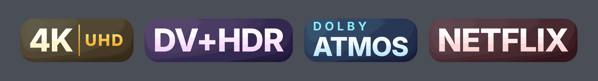</a><br><b>Glass</b></td><td align="center"><a href="#black--white">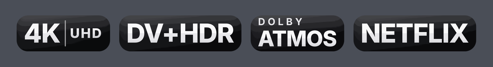</a><br><b>Black & White</b></td></tr><tr><td align="center"><a href="#white--black">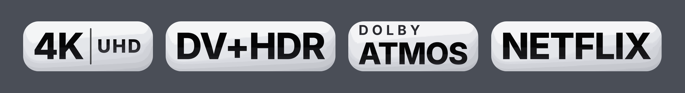</a><br><b>White & Black</b></td><td align="center"><a href="#neon">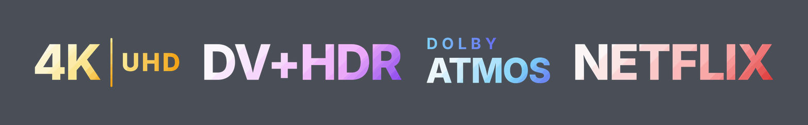</a><br><b>Neon</b></td></tr><tr><td align="center"><a href="#solid">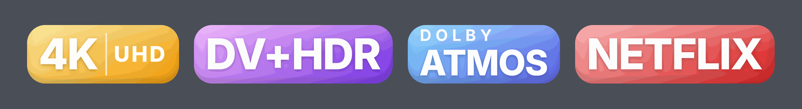</a><br><b>Solid</b></td><td align="center"><a href="#icon-dark">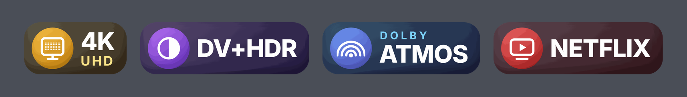</a><br><b>Icon Dark</b></td></tr><tr><td align="center"><a href="#split">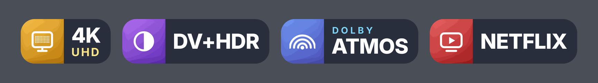</a><br><b>Split</b></td><td align="center"><a href="#frost">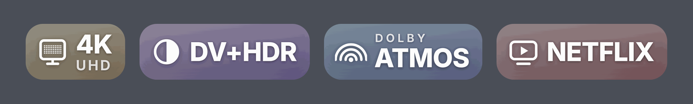</a><br><b>Frost</b></td></tr><tr><td align="center"><a href="#neon-icon">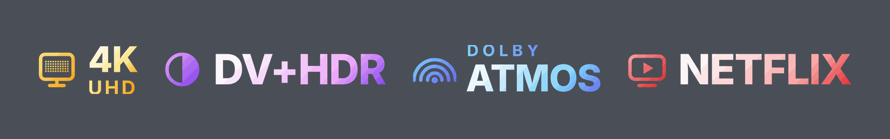</a><br><b>Neon Icon</b></td><td align="center"><a href="#minimal">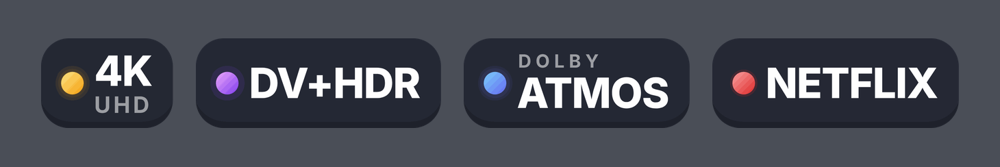</a><br><b>Minimal</b></td></tr><tr><td align="center"><a href="#light">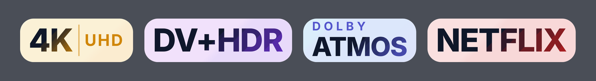</a><br><b>Light</b></td><td align="center"><a href="#icon-light">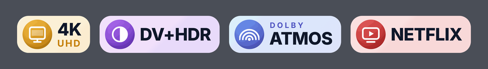</a><br><b>Icon Light</b></td></tr><tr><td align="center"><a href="#text-white">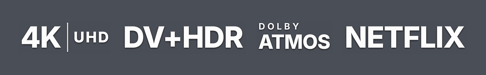</a><br><b>Text White</b></td><td align="center"><a href="#text-black">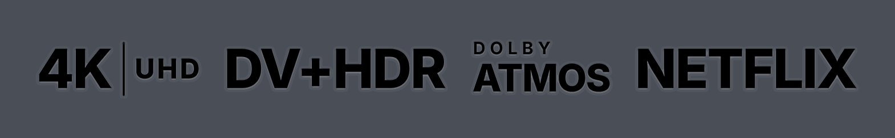</a><br><b>Text Black</b></td></tr>
</table>

## Styles

| Style | Look | Folder | Manifest |
|---|---|---|---|
| **Glass** | Dark tinted glass pills (text only) | `Badges` | `badges.json` |
| **Neon** | Glowing gradient text, no background (dark UIs) | `Badges-Neon` | `badges-neon.json` |
| **Solid** | Vivid gradient fills | `Badges-Solid` | `badges-solid.json` |
| **Icon Dark** | Gradient icon tiles on dark glass | `Badges-Icon-Dark` | `badges-icon-dark.json` |
| **Split** | Colored icon segment joined to a dark label | `Badges-Split` | `badges-split.json` |
| **Frost** | Translucent frosted glass for posters and backdrops | `Badges-Frost` | `badges-frost.json` |
| **Neon Icon** | Glowing gradient icons and text, no background (dark UIs) | `Badges-Neon-Icon` | `badges-neon-icon.json` |
| **Minimal** | Flat dark pills with a colored dot | `Badges-Minimal` | `badges-minimal.json` |
| **Light** | Soft pastel pills (light UIs) | `Badges-Light` | `badges-light.json` |
| **Icon Light** | Gradient icon tiles on pastel | `Badges-Icon-Light` | `badges-icon-light.json` |
| **Black & White** | Black glass pills with white text | `Badges-Black-White` | `badges-black-white.json` |
| **White & Black** | White glass pills with black text | `Badges-White-Black` | `badges-white-black.json` |
| **Text White** | White text only, no background | `Badges-Text-White` | `badges-text-white.json` |
| **Text Black** | Black text only, no background | `Badges-Text-Black` | `badges-text-black.json` |

## What's included

| Group | Count | Badges |
|---|---|---|
| Hero Badges | 5 | REMUX, 4K, Dolby Vision, Dolby Atmos, Cached |
| Editions & Cuts | 14 | IMAX, IMAX Enhanced, Open Matte, Criterion, Director's/Extended/Theatrical/Final Cut, Special, Unrated, Hybrid, Remastered, Proper/Repack, SeaDex |
| Release Source | 14 | REMUX, UHD Blu-ray, Blu-ray, WEB-DL, WEBRip, HDTV, DVD, TVRip, HDRip, HC HDRip, SCR, TC, TS, CAM |
| Resolution | 8 | 8K, 4K, 1440p, 1080p, 720p, 576p, 480p, 360p |
| Dynamic Range & Color | 13 | Dolby Vision, DV P7/P8, DV+HDR10, DV+HDR10+, HDR10+, HDR10, HDR, HLG, 12/10/8-bit, SDR |
| 3D & Broadcast | 6 | 3D, HFR, 60 FPS, 50 FPS, Live TV, Interlaced |
| Audio Codecs | 18 | Atmos, TrueHD, DTS:X, DTS-HD MA/HRA, DTS-ES, DTS, DD+, DD, AC-4, FLAC, ALAC, PCM, AAC, Opus, Vorbis, MP3, WMA |
| Video Codecs | 10 | VVC, AV1, HEVC, AVC, ProRes, VP9, VP8, VC-1, XviD, DivX |
| Containers | 4 | MKV, MP4, M2TS/TS, AVI |
| Audio Channels | 10 | 7.1.4 down to 1.0 Mono, including 7.1.2, 5.1.4, 5.1.2 |
| Streaming Platforms | 40 | Netflix, Prime Video, Apple TV+, Disney+, Max, Hulu, Paramount+, Peacock, JioHotstar, ZEE5, Crunchyroll and 29 more |
| Debrid & Caching | 5 | Real-Debrid, AllDebrid, Premiumize, TorBox, Debrid-Link |
| Languages | 78 | 78 languages with native names, including Latino, Cantonese, Hausa, Yoruba and English (US) / (UK) |
| Audio & Subs Flags | 9 | Multi/Dual Audio, Dubbed, Original Audio, Multi-Sub, Subpack, CC, Commentary, Audio Description |
| Subtitles | 10 | Subtitle badges for English, Malayalam, Tamil, Hindi, Telugu, Kannada, Japanese, Korean, Spanish and French, such as "Hindi Subs" |

**Total: 244 badges per style.**

## Usage

Copy the link for the style you want and use **one** style at a time. The guide above shows where to paste it.

### Glass


<details>
<summary>Preview</summary>

[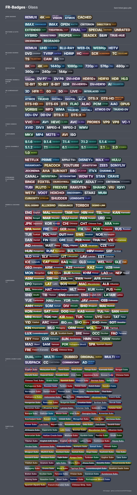](Previews/preview-glass.png)

</details>

```
https://raw.githubusercontent.com/farizmohd70/FR-Badges/main/badges.json
```

### Black & White


<details>
<summary>Preview</summary>

[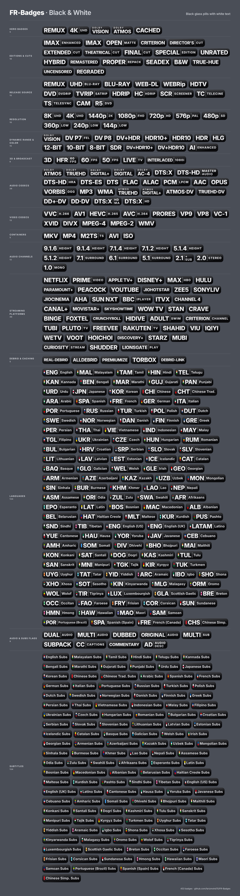](Previews/preview-black-white.png)

</details>

```
https://raw.githubusercontent.com/farizmohd70/FR-Badges/main/badges-black-white.json
```

### White & Black


<details>
<summary>Preview</summary>

[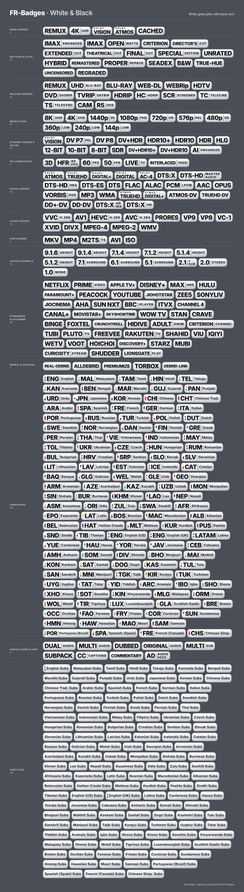](Previews/preview-white-black.png)

</details>

```
https://raw.githubusercontent.com/farizmohd70/FR-Badges/main/badges-white-black.json
```

### Text White


<details>
<summary>Preview</summary>

[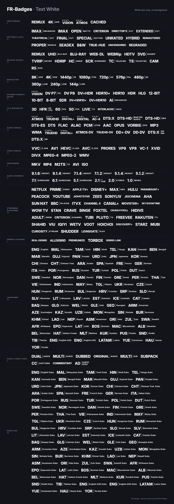](Previews/preview-text-white.png)

</details>

```
https://raw.githubusercontent.com/farizmohd70/FR-Badges/main/badges-text-white.json
```

### Text Black


<details>
<summary>Preview</summary>

[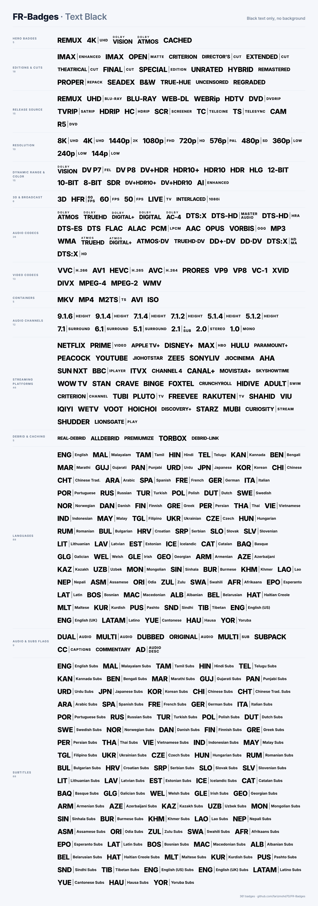](Previews/preview-text-black.png)

</details>

```
https://raw.githubusercontent.com/farizmohd70/FR-Badges/main/badges-text-black.json
```

### Neon


<details>
<summary>Preview</summary>

[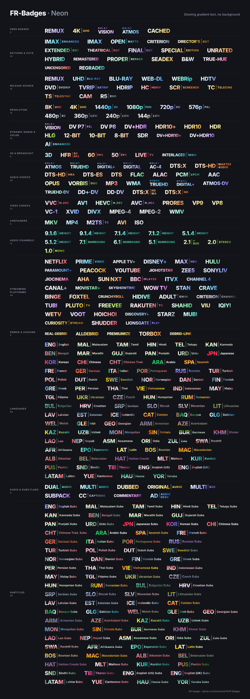](Previews/preview-neon.png)

</details>

```
https://raw.githubusercontent.com/farizmohd70/FR-Badges/main/badges-neon.json
```

### Solid


<details>
<summary>Preview</summary>

[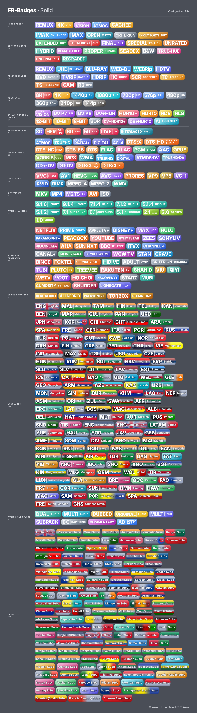](Previews/preview-solid.png)

</details>

```
https://raw.githubusercontent.com/farizmohd70/FR-Badges/main/badges-solid.json
```

### Icon Dark


<details>
<summary>Preview</summary>

[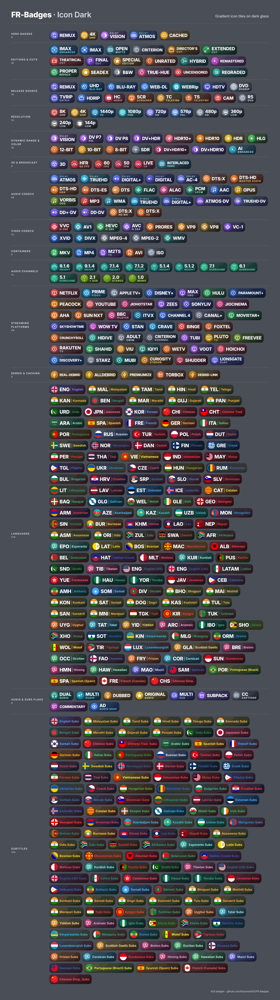](Previews/preview-icon-dark.png)

</details>

```
https://raw.githubusercontent.com/farizmohd70/FR-Badges/main/badges-icon-dark.json
```

### Split


<details>
<summary>Preview</summary>

[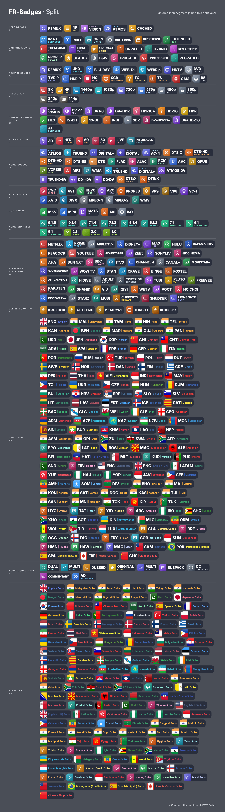](Previews/preview-split.png)

</details>

```
https://raw.githubusercontent.com/farizmohd70/FR-Badges/main/badges-split.json
```

### Frost


<details>
<summary>Preview</summary>

[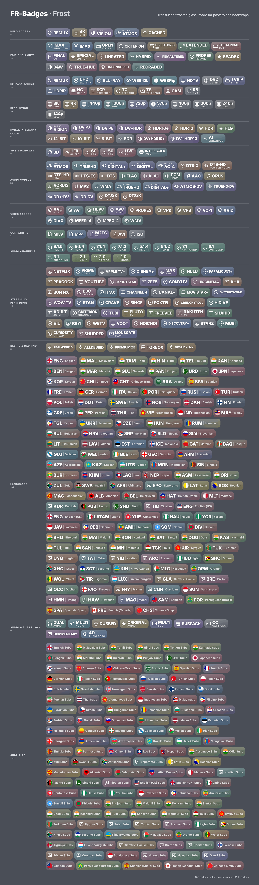](Previews/preview-frost.png)

</details>

```
https://raw.githubusercontent.com/farizmohd70/FR-Badges/main/badges-frost.json
```

### Neon Icon


<details>
<summary>Preview</summary>

[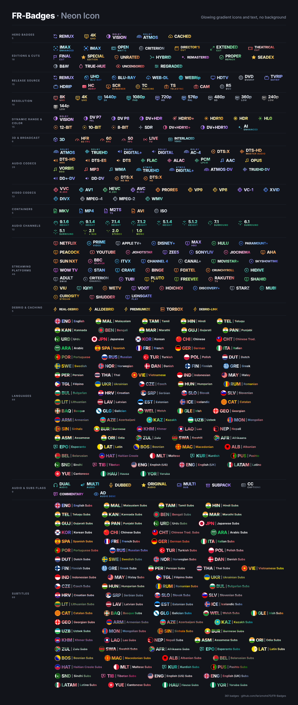](Previews/preview-neon-icon.png)

</details>

```
https://raw.githubusercontent.com/farizmohd70/FR-Badges/main/badges-neon-icon.json
```

### Minimal


<details>
<summary>Preview</summary>

[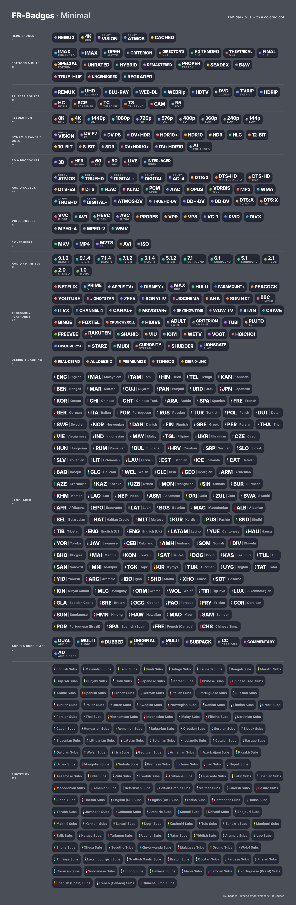](Previews/preview-minimal.png)

</details>

```
https://raw.githubusercontent.com/farizmohd70/FR-Badges/main/badges-minimal.json
```

### Light


<details>
<summary>Preview</summary>

[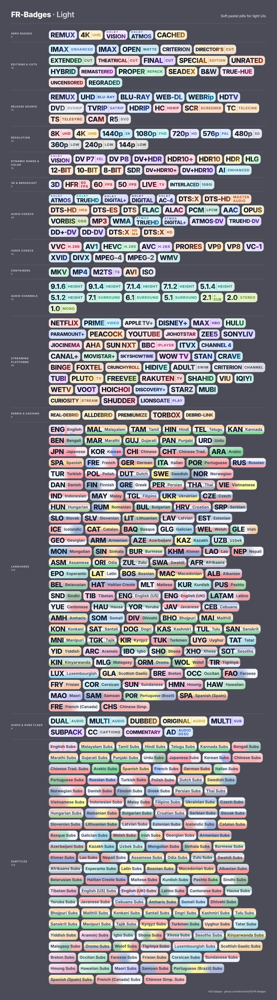](Previews/preview-light.png)

</details>

```
https://raw.githubusercontent.com/farizmohd70/FR-Badges/main/badges-light.json
```

### Icon Light


<details>
<summary>Preview</summary>

[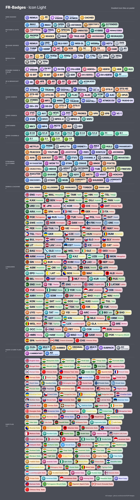](Previews/preview-icon-light.png)

</details>

```
https://raw.githubusercontent.com/farizmohd70/FR-Badges/main/badges-icon-light.json
```

If the app caches images, clear its cache after switching styles.

## License

[MIT](LICENSE) © farizmohd70

## Notes

- Badges are original designs with plain-text labels. They are not the official logos of Dolby, DTS, IMAX, Blu-ray Disc, streaming services or others.
- Images have no transparent margin, except the Neon style, which has a small one on the left and right so its two-line text is not cut by the app's rounded badge boundary. Neon and Neon Icon have no background shape, so they are cropped tight to the text.
- Only one badge shows per attribute: one resolution, one codec, one HDR type, and so on.
- Language and subtitle badges never overlap: "Hindi Subs" shows the Hindi subtitle badge only, and "Hindi" without "subs" shows the Hindi language badge only.
