<p align="center">
  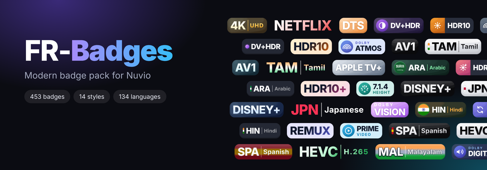
</p>

<p align="center">
  
  
  
  
</p>

<p align="center"><b>Modern badge pack for Nuvio.</b><br>1386 badges in 19 styles: hero badges, resolution, formats, dynamic range, codecs, audio, channels, sources, containers, editions, streaming platforms, debrid services, 167 languages, 167 subtitle badges and dubbed and short-name versions for every language. Every style has a ready-to-use filter manifest, and the website lets you build your own pack.</p>

<p align="center"><a href="https://farizmohd70.github.io/FR-Badges/"><b>Website</b></a> · <a href="https://farizmohd70.github.io/FR-Badges/make.html"><b>Make your pack</b></a></p>

---

## Quick start

1. Open Nuvio and go to **Profile**.
2. Tap **Layout**.
3. Open **Streams**.
4. Find **Fusion badge URLs** and paste the manifest link of the style you want. Copy it from [Usage](#usage) below.
5. Go back to your streams list. The new badges show on your stream tags.

> To switch styles, replace the link with another style's link. If the old badges still show, restart the app or clear its cache.

## Website

**https://farizmohd70.github.io/FR-Badges/**

The site shows every style live and lets you build a pack without editing any files.

1. Open **[Make your pack](https://farizmohd70.github.io/FR-Badges/make.html)**.
2. Pick a look (19 styles), then a starting set of badges. The Lite pack is a good start.
3. Tap the badges you want. You can search or browse by group, and mix styles per badge.
4. Set the order. Nuvio shows badges in that order.
5. Copy your link and paste it into Nuvio under **Fusion badge URLs**. Clear the cache afterwards.

You can also reopen an existing pack from its link, JSON or share code and keep editing it.

## Gallery

Tap a style to jump to its link and the full preview sheet. Every preview sheet shows all badges of that style on a grey background.

<table>
<tr><td align="center"><a href="#glass">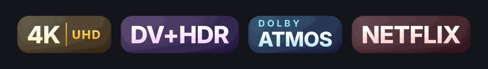</a><br><b>Glass</b></td><td align="center"><a href="#glass-vibrant">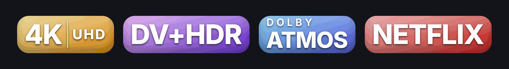</a><br><b>Glass Vibrant</b></td></tr><tr><td align="center"><a href="#solid">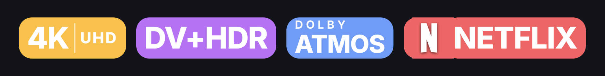</a><br><b>Solid</b></td><td align="center"><a href="#light">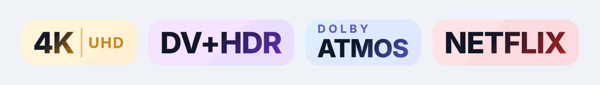</a><br><b>Light</b></td></tr><tr><td align="center"><a href="#pastel">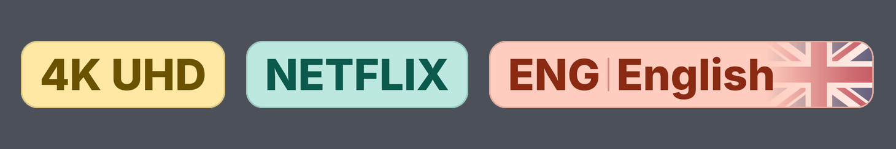</a><br><b>Pastel</b></td><td align="center"><a href="#frost">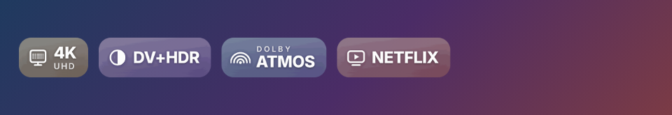</a><br><b>Frost</b></td></tr><tr><td align="center"><a href="#black--white">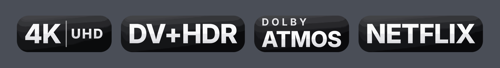</a><br><b>Black & White</b></td><td align="center"><a href="#white--black">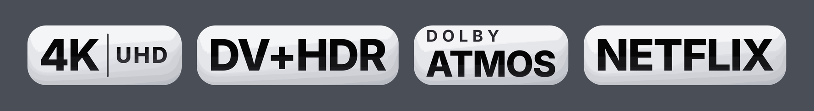</a><br><b>White & Black</b></td></tr><tr><td align="center"><a href="#text-white">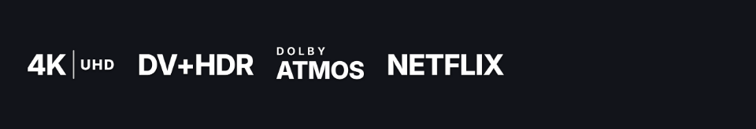</a><br><b>Text White</b></td><td align="center"><a href="#text-black">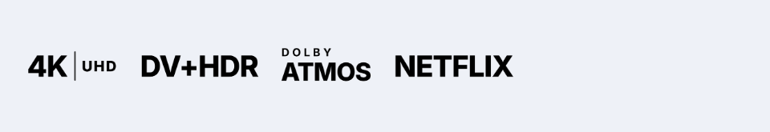</a><br><b>Text Black</b></td></tr><tr><td align="center"><a href="#neon">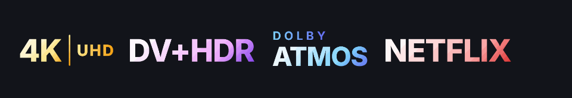</a><br><b>Neon</b></td><td align="center"><a href="#neon-icon">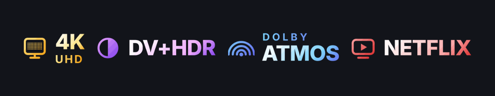</a><br><b>Neon Icon</b></td></tr><tr><td align="center"><a href="#icon-dark">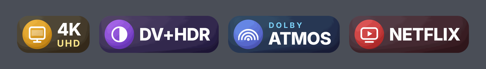</a><br><b>Icon Dark</b></td><td align="center"><a href="#icon-light">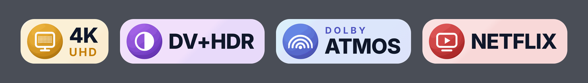</a><br><b>Icon Light</b></td></tr><tr><td align="center"><a href="#split">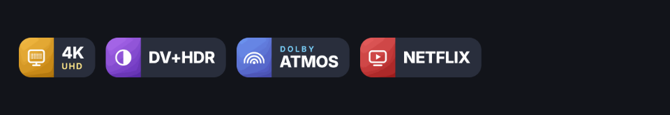</a><br><b>Split</b></td><td align="center"><a href="#minimal">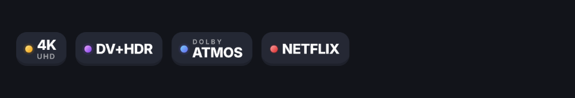</a><br><b>Minimal</b></td></tr><tr><td align="center"><a href="#pixel">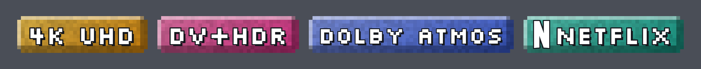</a><br><b>Pixel</b></td><td align="center"><a href="#glow-bar">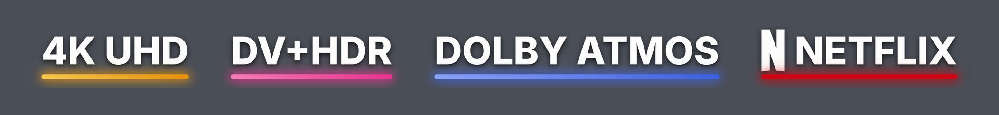</a><br><b>Glow Bar</b></td></tr><tr><td align="center"><a href="#midnight-teal-animated">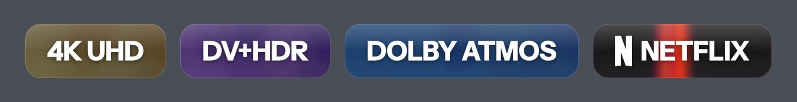</a><br><b>Midnight Teal</b> (animated)</td></tr>
</table>

## Styles

<details>
<summary>Show styles</summary>

| Style | Look | Folder | Manifest |
|---|---|---|---|
| **Glass** | Dark tinted glass pills (text only) | `Badges` | `badges.json` |
| **Glass Vibrant** | Glass pills in vivid candy colours, white text | `Badges-Glass-Vibrant` | `badges-glass-vibrant.json` |
| **Pixel** | Pixel-art blocks with chunky retro text | `Badges-Pixel` | `badges-pixel.json` |
| **Glow Bar** | Bold text, no background, with a glowing accent line | `Badges-Glow-Bar` | `badges-glow-bar.json` |
| **Midnight Teal** (animated) | Animated liquid glass pills; streaming badges play the platform's intro blurred in the background | `Badges-Midnight-Teal` | `badges-midnight-teal.json` |
| **Solid** | Flat single-colour pills, white text | `Badges-Solid` | `badges-solid.json` |
| **Light** | Soft pastel pills (light UIs) | `Badges-Light` | `badges-light.json` |
| **Pastel** | Each category in its own soft colour, flags on languages | `Badges-Pastel` | `badges-pastel.json` |
| **Frost** | Translucent frosted glass for posters and backdrops | `Badges-Frost` | `badges-frost.json` |
| **Black & White** | Black glass pills with white text | `Badges-Black-White` | `badges-black-white.json` |
| **White & Black** | White glass pills with black text | `Badges-White-Black` | `badges-white-black.json` |
| **Text White** | White text only, no background | `Badges-Text-White` | `badges-text-white.json` |
| **Text Black** | Black text only, no background | `Badges-Text-Black` | `badges-text-black.json` |
| **Neon** | Glowing gradient text, no background (dark UIs) | `Badges-Neon` | `badges-neon.json` |
| **Neon Icon** | Glowing gradient icons and text, no background (dark UIs) | `Badges-Neon-Icon` | `badges-neon-icon.json` |
| **Icon Dark** | Gradient icon tiles on dark glass | `Badges-Icon-Dark` | `badges-icon-dark.json` |
| **Icon Light** | Gradient icon tiles on pastel | `Badges-Icon-Light` | `badges-icon-light.json` |
| **Split** | Colored icon segment joined to a dark label | `Badges-Split` | `badges-split.json` |
| **Minimal** | Flat dark pills with a colored dot | `Badges-Minimal` | `badges-minimal.json` |

</details>

## What's included

<details>
<summary>Show what's included</summary>

| Group | Count | Badges |
|---|---|---|
| Hero Badges | 5 | REMUX, 4K, Dolby Vision, Dolby Atmos, Cached |
| Editions & Cuts | 18 | IMAX, IMAX Enhanced, Open Matte, Criterion, Director's/Extended/Theatrical/Final Cut, Special, Unrated, Hybrid, Remastered, Proper/Repack, SeaDex, Black & White, True-Hue, Uncensored, Regraded |
| Release Source | 15 | REMUX, UHD Blu-ray, Blu-ray, WEB-DL, WEBRip, HDTV, DVD, TVRip, HDRip, HC HDRip, SCR, TC, TS, CAM, R5 |
| Release Group Tiers | 20 | Ranked release groups as icon and number: REMUX 1-3, BLU-RAY 1-8, WEB 1-6, plus an Unranked badge for each source |
| Resolution | 10 | 8K, 4K, 1440p, 1080p, 720p, 576p, 480p, 360p, 240p, 144p |
| Dynamic Range & Color | 15 | Dolby Vision, DV P7/P8, DV+HDR10, DV+HDR10+, HDR10+, HDR10, HDR, HLG, 12/10/8-bit, SDR, AI Enhanced |
| 3D & Broadcast | 6 | 3D, HFR, 60 FPS, 50 FPS, Live TV, Interlaced |
| Audio Codecs | 26 | Atmos, TrueHD, DTS:X, DTS-HD MA/HRA, DTS-ES, DTS, DD+, DD, AC-4, FLAC, ALAC, PCM, AAC, Opus, Vorbis, MP3, WMA, plus combined Atmos and Dolby Vision badges |
| Video Codecs | 13 | VVC, AV1, HEVC, AVC, ProRes, VP9, VP8, VC-1, XviD, DivX, MPEG-4, MPEG-2, WMV |
| Containers | 5 | MKV, MP4, M2TS/TS, AVI, ISO |
| Audio Channels | 12 | 9.1.6 and 9.1.4 down to 1.0 Mono, including 7.1.4, 7.1.2, 5.1.4, 5.1.2 |
| Streaming Platforms | 46 | Netflix, Prime Video, Apple TV+, Disney+, Max, Hulu, Paramount+, Peacock, YouTube, JioHotstar, ZEE5, Crunchyroll, BBC iPlayer, Canal+, Tubi, MUBI and 30 more |
| Debrid & Caching | 5 | Real-Debrid, AllDebrid, Premiumize, TorBox, Debrid-Link |
| Languages | 167 | 167 languages with native names and flags, including regional versions (English US/UK, Portuguese Brazil, Spanish Spain, French Canada, Chinese Simplified), and lesser-used ones like Javanese, Cebuano, Amharic, Somali, Bhojpuri, Sanskrit, Igbo, Xhosa, Scottish Gaelic and Maori |
| Language Codes | 167 | Every language as a short code, such as ENG or HIN |
| Language Names | 167 | Every language as its full name, such as ENGLISH or HINDI |
| Dubbed Short | 167 | Short code and DUB for every language, such as HIN \| DUB |
| Dubbed Full | 167 | Full language name and DUB for every language, such as HINDI \| DUB |
| Audio & Subs Flags | 11 | Multi/Dual Audio, Dubbed, Multi-Dub, Subbed, Original Audio, Multi-Sub, Subpack, CC, Commentary, Audio Description |
| Subtitles | 167 | One subtitle badge for every language, such as "Hindi Sub" (full language name) |
| Subtitles Short | 167 | The same subtitles with a short code, such as HIN SUB |

**Total: 1386 badges per style.** The ready-made manifests (`badges.json` and the style files) are the Lite pack with 220 of them. The rest are available when you build your own pack on the [website](https://farizmohd70.github.io/FR-Badges/make.html).

</details>

## Usage

Copy the link for the style you want and use **one** style at a time. The guide above shows where to paste it.

### Glass


<details>
<summary>Preview</summary>

[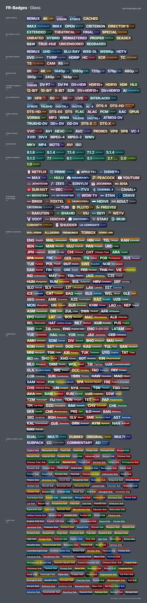](Previews/preview-glass.png)

</details>

```
https://raw.githubusercontent.com/farizmohd70/FR-Badges/main/badges.json
```

### Glass Vibrant


<details>
<summary>Preview</summary>

[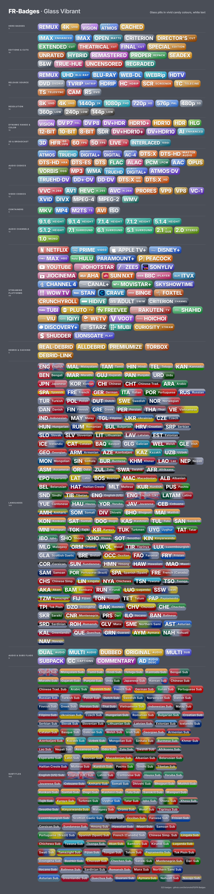](Previews/preview-glass-vibrant.png)

</details>

```
https://raw.githubusercontent.com/farizmohd70/FR-Badges/main/badges-glass-vibrant.json
```

### Pixel


<details>
<summary>Preview</summary>

[](Previews/preview-pixel.png)

</details>

```
https://raw.githubusercontent.com/farizmohd70/FR-Badges/main/badges-pixel.json
```

### Glow Bar


<details>
<summary>Preview</summary>

[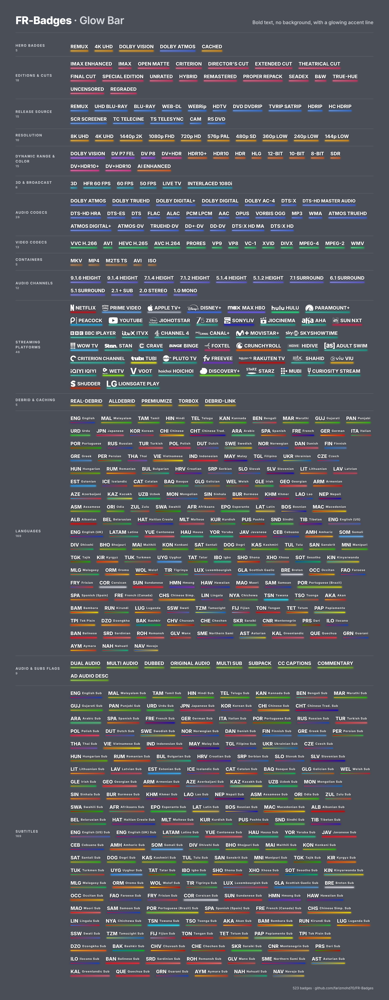](Previews/preview-glow-bar.png)

</details>

```
https://raw.githubusercontent.com/farizmohd70/FR-Badges/main/badges-glow-bar.json
```

### Midnight Teal (animated)

<p>
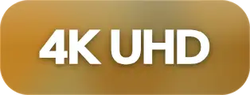


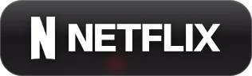
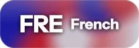
</p>

Animated WebP badges with liquid glass colour, Glass-style tints, flag-colour liquid for languages and subtitles, and blurred streaming intros behind platform badges. The gallery images show a still frame; the badges animate in Nuvio.

<details>
<summary>Preview</summary>

[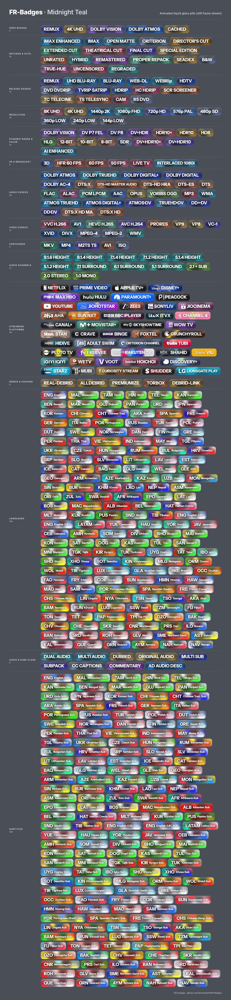](Previews/preview-midnight-teal.png)

</details>

```
https://raw.githubusercontent.com/farizmohd70/FR-Badges/main/badges-midnight-teal.json
```

### Solid


<details>
<summary>Preview</summary>

[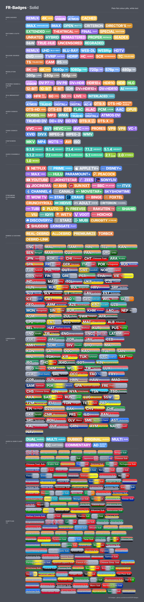](Previews/preview-solid.png)

</details>

```
https://raw.githubusercontent.com/farizmohd70/FR-Badges/main/badges-solid.json
```

### Light


<details>
<summary>Preview</summary>

[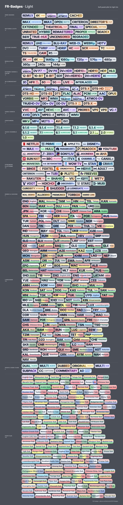](Previews/preview-light.png)

</details>

```
https://raw.githubusercontent.com/farizmohd70/FR-Badges/main/badges-light.json
```

### Pastel


<details>
<summary>Preview</summary>

[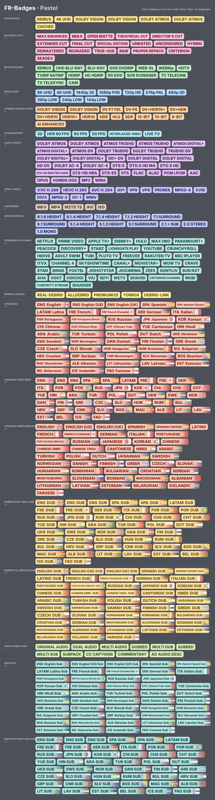](Previews/preview-pastel.png)

</details>

```
https://raw.githubusercontent.com/farizmohd70/FR-Badges/main/badges-pastel.json
```

### Frost


<details>
<summary>Preview</summary>

[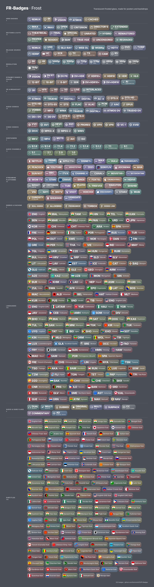](Previews/preview-frost.png)

</details>

```
https://raw.githubusercontent.com/farizmohd70/FR-Badges/main/badges-frost.json
```

### Black & White


<details>
<summary>Preview</summary>

[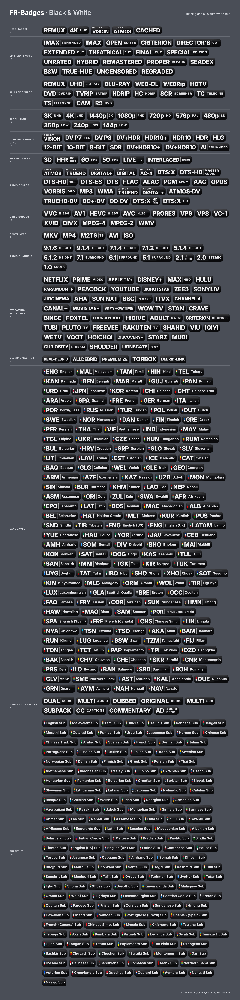](Previews/preview-black-white.png)

</details>

```
https://raw.githubusercontent.com/farizmohd70/FR-Badges/main/badges-black-white.json
```

### White & Black


<details>
<summary>Preview</summary>

[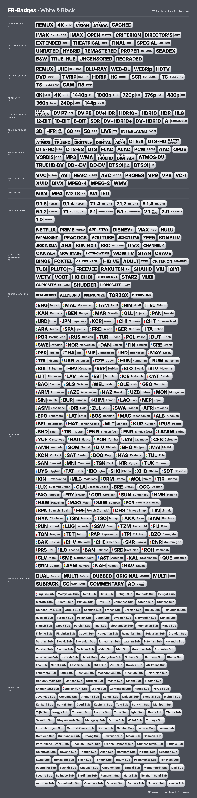](Previews/preview-white-black.png)

</details>

```
https://raw.githubusercontent.com/farizmohd70/FR-Badges/main/badges-white-black.json
```

### Text White


<details>
<summary>Preview</summary>

[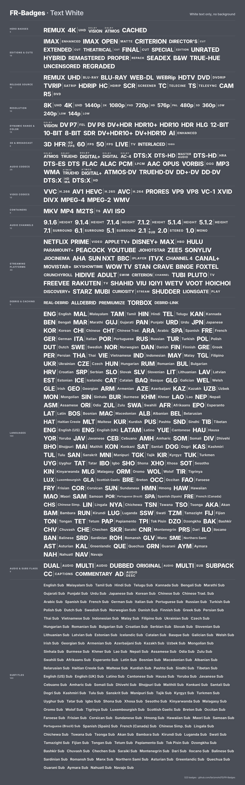](Previews/preview-text-white.png)

</details>

```
https://raw.githubusercontent.com/farizmohd70/FR-Badges/main/badges-text-white.json
```

### Text Black


<details>
<summary>Preview</summary>

[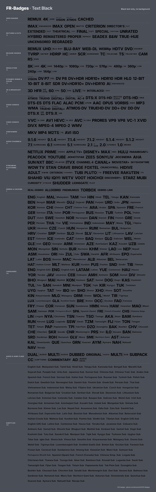](Previews/preview-text-black.png)

</details>

```
https://raw.githubusercontent.com/farizmohd70/FR-Badges/main/badges-text-black.json
```

### Neon


<details>
<summary>Preview</summary>

[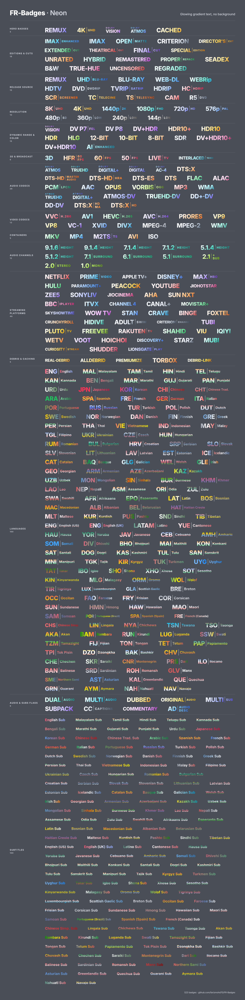](Previews/preview-neon.png)

</details>

```
https://raw.githubusercontent.com/farizmohd70/FR-Badges/main/badges-neon.json
```

### Neon Icon


<details>
<summary>Preview</summary>

[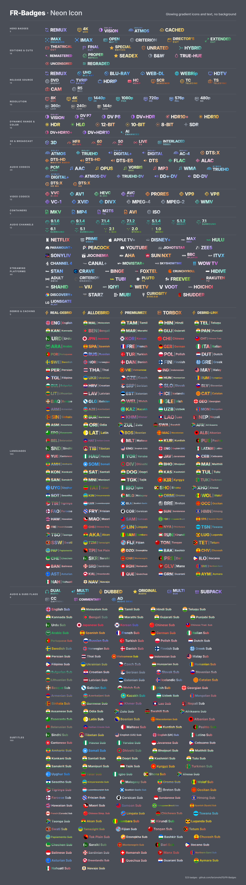](Previews/preview-neon-icon.png)

</details>

```
https://raw.githubusercontent.com/farizmohd70/FR-Badges/main/badges-neon-icon.json
```

### Icon Dark


<details>
<summary>Preview</summary>

[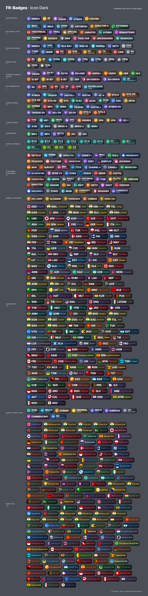](Previews/preview-icon-dark.png)

</details>

```
https://raw.githubusercontent.com/farizmohd70/FR-Badges/main/badges-icon-dark.json
```

### Icon Light


<details>
<summary>Preview</summary>

[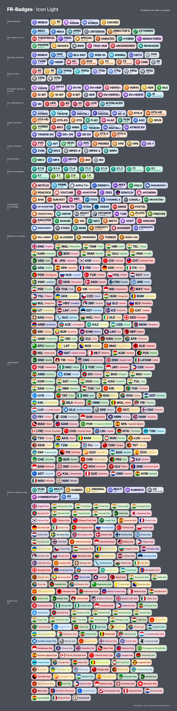](Previews/preview-icon-light.png)

</details>

```
https://raw.githubusercontent.com/farizmohd70/FR-Badges/main/badges-icon-light.json
```

If the app caches images, clear its cache after switching styles.

### Split


<details>
<summary>Preview</summary>

[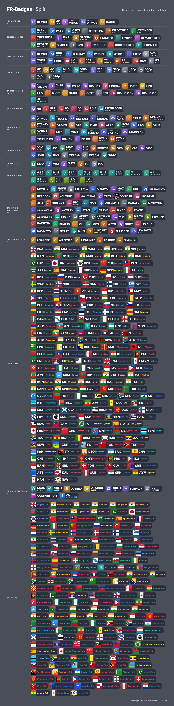](Previews/preview-split.png)

</details>

```
https://raw.githubusercontent.com/farizmohd70/FR-Badges/main/badges-split.json
```

### Minimal


<details>
<summary>Preview</summary>

[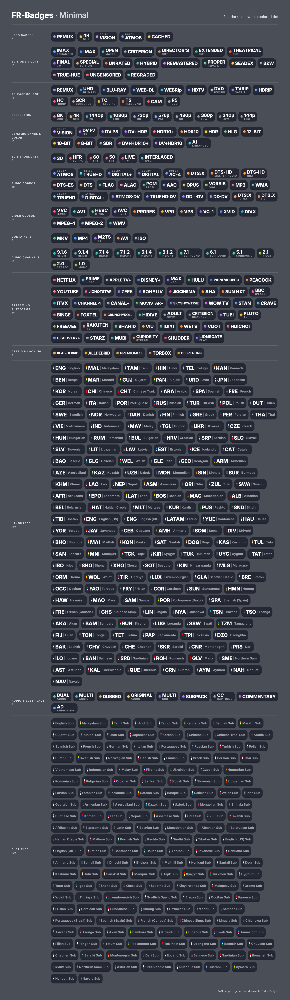](Previews/preview-minimal.png)

</details>

```
https://raw.githubusercontent.com/farizmohd70/FR-Badges/main/badges-minimal.json
```
## License

[MIT](LICENSE) © farizmohd70

## Notes

- Badges are original designs with plain-text labels. They are not the official logos of Dolby, DTS, IMAX, Blu-ray Disc, streaming services or others.
- All badges are sized for Nuvio's 16dp badge height, so text fills the chip and edges stay clear of its rounded corners. Images have no transparent margin, except the Neon style, which has a small one on the left and right so its two-line text is not cut by the app's rounded badge boundary. Neon and Neon Icon have no background shape, so they are cropped tight to the text.
- Only one badge shows per attribute: one resolution, one codec, one HDR type, and so on.
- Language and subtitle badges never overlap: "Hindi Subs" shows the Hindi subtitle badge only, and "Hindi" without "subs" shows the Hindi language badge only.
